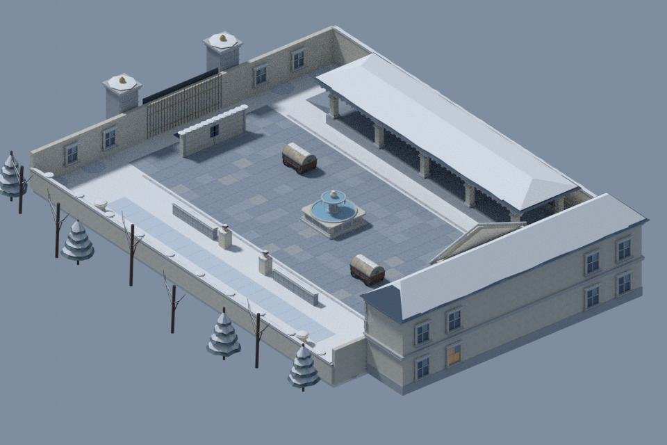
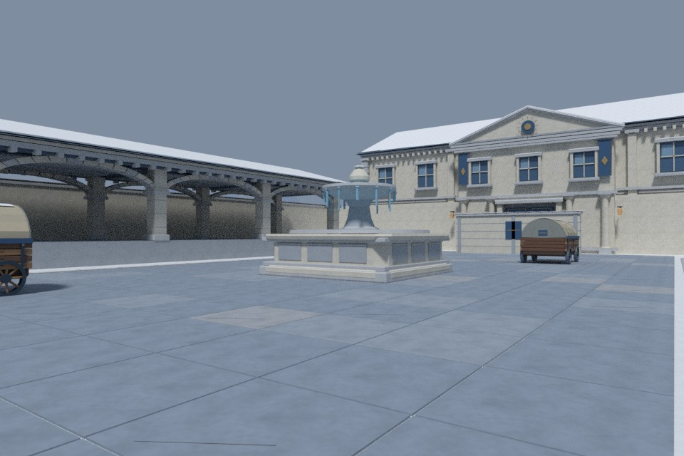

# FROSTCOURT · 永冬庭院

Napoleon chapter arena: **60 × 48 m** fictional imperial snow courtyard. A frozen
ceremonial fountain anchors the middle; a roofed arcade and open park edge create
contrasting northern/southern circulation. The eastern palace and western grille
gate have deliberately different silhouettes. Architecture is anime fiction,
not a reconstruction of a named palace or historical battle.





## R4 art direction

- **Architecture:** recessed reflective sash windows, multi-level cornices,
  dressed corner stones, engaged columns, complete extruded elliptical arcade
  voussoirs and a triangular relief pediment with an original geometric crest.
- **Hero/cover:** stepped clipped-corner fountain basin, curved upper bowl,
  sculpted stem, frozen water cracks and irregular icicles; period-inspired
  supply wagons have arched canvas, seam ribs, timber boards, steel-rimmed
  spoked wheels, iron fasteners and canvas-ridge snow instead of box bodies.
- **Materials:** 18 tiny original embedded maps across six material families
  (stone, paving, timber, snow, canvas, slate): base colour, packed ORM and normal.
  These are actual GLB channels, not Blender-only shaders or a lighting trick.
  Palette remains cold blue-grey/ivory with restrained blue fabric, old gold and
  a few amber windows/lanterns. Fine grain supports silhouettes, not visual noise.
- **Snow/design layers:** irregular continuous roof caps with exposed slate,
  shaped coping accumulation, shallow park drifts and branched winter silhouettes and snow-laden firs.
  Foreground wagon/fountain detail, readable central circulation, architectural
  backdrop and distant hills have distinct visual roles.
- **SAKURA benchmark:** inspected its original source and actual overview/sando
  previews. The response is equivalent thematic landmarks, repeated architectural
  rhythm, colour hierarchy and foreground/mid/background layering—not transplanting
  shrine forms or its warm dusk palette. Same-condition comparative renders are
  independently maintained in `../../docs/chapter-qa/`; quality remains a visual
  judgment, not something triangle counts alone prove. SAKURA is unmodified.

## Rebuild and checks

```sh
# Optional: regenerate original deterministic material maps (Pillow required).
python3 arena-maps/frostcourt/source/make_materials.py
# Rebuild meshes from checked-in source and textures; no Blender dependency.
python3 arena-maps/frostcourt/source/build.py
python3 arena-maps/frostcourt/validation/validate_art.py
# Actual GLB pixel inspection (not browser screenshots).
QA_RENDER_OUTPUT=arena-maps/frostcourt/validation/renders-r4 \
  blender -b --factory-startup -t 4 \
  --python docs/chapter-qa/render_arena_assets.py -- frostcourt
cd arena-game && npx vitest run test/maps.test.ts test/chapter-qa.test.ts
```

`source/build.py` authors JSON, visual and collision GLBs. Shared `chapterkit`
embeds the checked-in maps from `assets/materials/`; `source/make_materials.py`
contains the deterministic mathematical synthesis. `assets/materials/provenance.json`
records source/provenance, dimensions and every image hash; no external imagery,
scanned materials or third-party assets are used.

**Export:** 34,562 visual triangles, 32 mesh nodes, approximately 2.96 MB including
18 embedded 128 × 128 images. Decorative craft stays in one material-batched node;
real cover meshes remain separately identifiable. Extra geometry is concentrated
in the arcade vaults, moulded fountain and wagon construction rather than flat
floors. No draw-call/FPS performance claim is implied by the budget.

## Gameplay contract and verification limits

R4 retains **byte-identical collision GLB** and unchanged bounds, player settings,
objects, spawn/cover/objective anchors and routes from R2. Exact hash comparisons,
material channel checks, no-external-URI checks, triangle budget and repeat-export
determinism are in `validation/art_report.json`. `validation/glb_report.json`
checks all VIS/COL containment and embedded texture/UV structure. Sculpted cover
uses the same conservative proxy volumes; shallow decorative relief is not extra
collision. Snow never changes friction or buries movement edges.

Both offline/online RoomCore use the same `frostcourt` registry and `snowcourt`
preset. The northern arcade remains 1.3 m high with two ramps; the southern bypass
remains open. Playability/LOS/nav/network checks are independently maintained in
`../../docs/ARENA_CHAPTER_QA.md`. Human PvP balance and device performance remain
open. Chromium browser inspection is blocked by the sandbox socket restriction;
Blender CPU Cycles previews are **actual exported GLB renders**, not in-game
screenshots, browser acceptance or GPU benchmarks. Final image manifests record
the exact GLB hash and camera/light conditions.

Close-up inspection: [fountain](previews/03-fountain.jpg), [wagon](previews/04-wagon.jpg), [arcade](previews/05-arcade.jpg). Reproduce with `blender -b --factory-startup -t 4 --python arena-maps/frostcourt/validation/render_details.py`.
