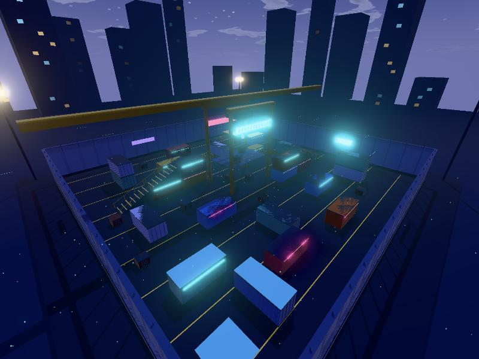

# Parhelion · NEON 夜港 0.1.0

第四张 Arena 地图：夜晚的集装箱码头。56 × 56 米（四张图里唯一的正方形），1 单位 = 1 米，Y 轴向上，支持 1v1／1v2／2v2，数据格式与 `arena/`（ASTER）相同。**点对称**（(x, z) → (−x, −z)），但出生点在**对角的两个角落**（A 西南、B 东北），所有交火都沿对角线展开。



## 设计：集装箱迷宫 + 吊车甲板

其它三张分别是开阔中庭（ASTER）、三层阶梯（ZENITH）、三路加室内（SAKURA），这张是**迷宫**：

| 区域 | 内容 | 打法 |
|---|---|---|
| 集装箱场 | 6 米长、2.6 米高的集装箱排出短走廊、盲角和放着木箱的路口 | 一直在近中距离探头对枪，霰弹和步枪的天下 |
| 集装箱阶梯 | 每队一条：地面 → 坡道 → 2.6 米集装箱顶 → 第二段坡道 → 5.2 米双层箱顶 → 猫道 | 唯一能上到高处的路线，阶梯窄（2.6 米），上楼时容易被堵 |
| 吊车甲板 | 中央十字路口正上方的 5.2 米钢甲板，两条猫道分别连着两队的阶梯 | 能看到几乎整个码头，但看不到甲板正下方，底下的人可以躲着穿过去 |
| 码头边路 | 沿围栏的开阔边路 | 绕开迷宫转点 |

## 氛围

`presentation.preset = "night"`：深蓝夜空和星星、冷色月光、更强的辉光，空中飘着青色光尘。集装箱侧面的霓虹灯条、吊车上的招牌、围栏上的霓虹牌、远处城市的窗户和起重机灯都会自发光。

## 文件

- `source/make_map.py`：游戏布局 → `runtime/map.json`。
- `source/build_glb.py`：用 `../_lib/glbkit.py` 生成 `assets/neon_visual.glb`（约 2.1 万三角形，1.3 MB）和 `assets/neon_collision.glb`。纯 Python 3，不需要 Blender。
- `validation/check_glb.py`：调用 `../_lib/check_glb.py`。
- `previews/`：游戏内截图。

装饰（集装箱瓦楞和门杆、楼梯防滑条和栏杆、吊车上半部分和吊臂、围栏网、高杆灯、水面、城市天际线、月亮）都没有碰撞。

## 重建与测试

```sh
python3 source/make_map.py
python3 source/build_glb.py
python3 validation/check_glb.py
cd ../../arena-game && npx vitest run test/maps.test.ts
```

测试额外检查：出生点在对角角落、两个出生点都能沿寻路走到甲板、横穿和对角穿过中心的地面视线都被挡住、甲板上看不到正下方的人。

## 已知限制

- 只经过 Bot 对局和静态检查，还没有真人对局验证平衡。
- 从甲板或箱顶跳下不掉血，Bot 不会主动往下跳（寻路最大落差 3.6 米）。
