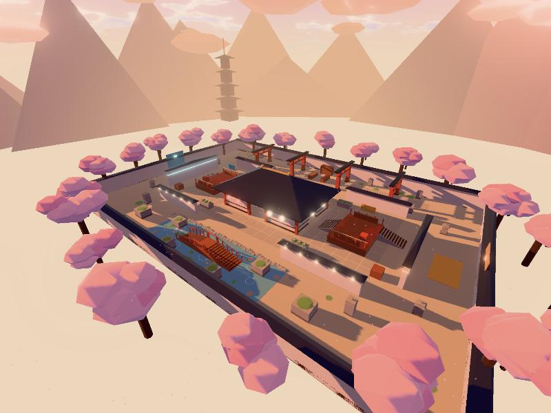

# Parhelion · SAKURA 樱庭 0.1.0

第三张 Arena 地图：黄昏的神社境内。64 × 44 米，1 单位 = 1 米，Y 轴向上，支持 1v1／1v2／2v2，数据格式与 `arena/`（ASTER）相同。左右**镜像对称**（x → −x），A 队在西，B 队在东。



## 设计：经典三路

这是成熟战术射击里最常见的三路结构，ASTER（开阔中庭 + 长廊高台）没有用过：

| 路 | 场景 | 打法 |
|---|---|---|
| 北路 | 参道：两排鸟居和石灯笼下的石板路 | 地图里唯一能打 30 米以上的长线，DMR 对狙；鸟居柱子和灯笼把视线切成几段 |
| 中路 | 拜殿：中央带屋顶的神社大殿，南北各一个 4 米门、东西各一个 3 米门，内有 4 根柱子和 3 米高的本殿 | 所有地图里第一个**室内**空间，霰弹近战；两侧各有 1.2 米高的神乐台正对大殿侧门，但本殿挡住了「台对台」的穿殿长枪线 |
| 南路 | 锦鲤池：浅池（可走）、拱桥（中间 1.2 米高）、池石 | 中距离，桥上有一点高度优势 |

三路之间用带瓦顶的院墙隔开，只在大殿前后连通。出生点在两端的照壁后面，南北两头出口。

## 氛围

`map.json` 里 `presentation.preset = "dusk"`：低角度的橙色夕阳、粉紫色天空、暖色雾、更强的辉光（Bloom），空中飘着樱花瓣。纸灯笼、石灯笼的火口和队伍灯带自发光，在辉光下会亮起来。

## 文件

- `source/make_map.py`：游戏布局 → `runtime/map.json`。
- `source/build_glb.py`：用共享工具 `../_lib/glbkit.py` 生成 `assets/sakura_visual.glb`（约 2.2 万三角形，1.7 MB，纯因子材质）和 `assets/sakura_collision.glb`。纯 Python 3，不需要 Blender。
- `validation/check_glb.py`：调用 `../_lib/check_glb.py`，检查模型与 `map.json` 一致。
- `previews/`：游戏内截图。

装饰（大殿和墙上的瓦顶、鸟居横梁、灯笼、樱花树、池里的锦鲤和睡莲、远山和五重塔）都没有碰撞。

## 重建

```sh
python3 source/make_map.py
python3 source/build_glb.py
python3 validation/check_glb.py
cd ../../arena-game && npx vitest run test/maps.test.ts
```

测试额外检查：镜像对称、大殿有屋顶（室内有天花板，参道没有）、两个神乐台之间的穿殿视线被本殿挡住、参道上存在 40 米长视线而中路没有。

## 已知限制

- 只经过 Bot 对局和静态检查，还没有真人对局验证平衡。
- 池水只是视觉效果，在池里走路速度不变。
