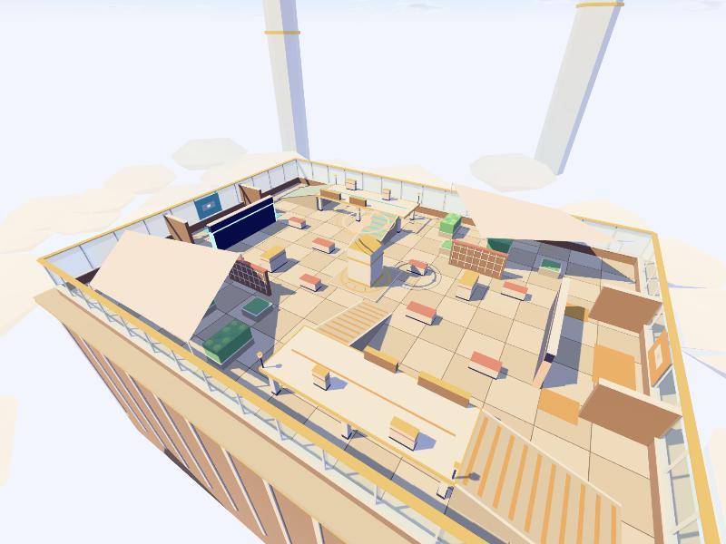

# Parhelion · ZENITH 日冕天台 0.1.0

第二张 Arena 地图。60 × 44 米露天天台，1 单位 = 1 米，Y 轴向上，支持 1v1／1v2／2v2。数据格式与 `arena/`（ASTER 研究站）完全相同，`arena-game/` 直接读取本目录的 `runtime/map.json` 和 `assets/zenith_visual.glb`，大厅里选「ZENITH 日冕天台」即可。ASTER 原地图没有任何改动。



## 设计

和 ASTER 的镜像对称、单条北侧长廊不同，ZENITH 用**点对称**（(x, z) → (−x, −z)，即旋转 180°）：每队各拥有一座对角高台和一条地面侧翼，双方拿到的地形完全等价。

| 区域 | 作用 |
|---|---|
| 出生凹室（东西两端） | 4.4 米高屏风挡住正面，南北各一个约 3.6 米的斜门。对面出生点、对面高台、中庭都看不到出生点（测试逐条射线验证）。 |
| 对角高台（A 西北 / B 东南） | 3 米高，17×6 米。己方从出生点旁的 10 米**主坡道**上，敌方可从中庭的 4 米**反制坡道**冲上来。朝中庭一侧只有 1.1 米半掩体，后方 1.7 米立板挡反制坡道。 |
| 高台下廊道 | 2.6 米净高，有柱子可绕。敌人能贴着高台下面摸过去，高台上的人看不到正下方。 |
| 花园侧翼（北半东侧 / 南半西侧） | 每队的地面侧翼都通往**敌方高台**脚下：高矮花坛、格栅屏风、遮阳帆，适合霰弹枪近战，用来反制高台。 |
| 日晷中庭 | 5 米高的日晷柱挡死出生点对出生点、高台中心对高台中心两条长视线；周围有半掩体、高掩体和 0.24 米台阶的日晷台。 |

参考的是成熟竞技射击地图的通用原则：三条路线、每条路线至少两种进攻角度、高台一定有可被绕后的反制路线、长视线被中景物体切断、出生点不可被直接压制。没有复制任何现有地图的布局或资源。

## 文件

- `source/make_map.py`：游戏布局（碰撞盒、坡道、锚点、路线），写出 `runtime/map.json`。
- `source/build_glb.py`：纯 Python 3 生成美术模型，不需要 Blender 或任何依赖，输出可重复。
  - `assets/zenith_visual.glb`：72 个节点（每个地图物体一个 `VIS_*` 节点 + 装饰批次），约 1.1 万三角形，0.8 MB，纯因子 PBR 材质，无贴图。游戏加载时统一换成卡通（cel）材质，和 ASTER 风格一致。
  - `assets/zenith_collision.glb`：59 个碰撞代理，仅供查看；游戏碰撞只读 `map.json`。
- `validation/check_glb.py`：检查每个物体都有模型、碰撞代理与 `map.json` 完全一致、可见模型不超出碰撞盒、无贴图、预算。
- `previews/`：在游戏里截的图。

装饰（窗框、花坛上的叶团、遮阳帆、日晷光环、远处的塔和云海）全部没有碰撞，叶团最多高出花坛 0.2 米；子弹可以穿过这部分装饰。

## 重建

```sh
python3 source/make_map.py
python3 source/build_glb.py
python3 validation/check_glb.py
cd ../../arena-game && npx vitest run test/maps.test.ts
```

`arena-game/test/maps.test.ts` 用游戏本身的物理、视线和寻路代码检查每张注册地图：锚点落地且不在实体内、敌对出生点互不可见、`routes` 里四条路线正反两向都能用真实移动走通、寻路网格连通所有出生点/掩体/目标点、四个 Bot 能打出击杀；ZENITH 另外检查点对称、高台看不到敌方出生点、中庭看不到任何出生点、两座高台中心互相不可见。

## 已知限制

- 新地图的竞技平衡只经过 Bot 对局和静态视线检查，还没有真人对局验证。
- 高台边缘没有护栏碰撞，可以直接跳下（和 ASTER 一致）。
- 预览图是浏览器面板里的截图，不是 Blender 渲染。
