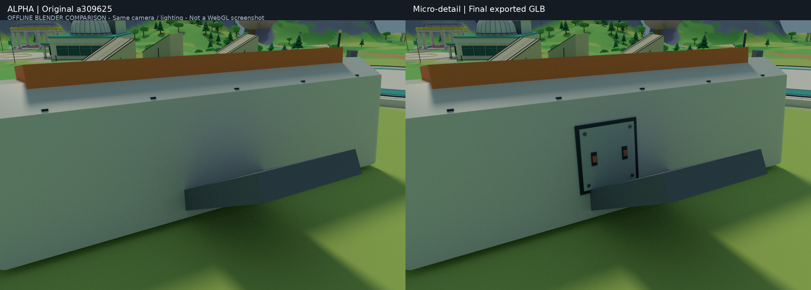
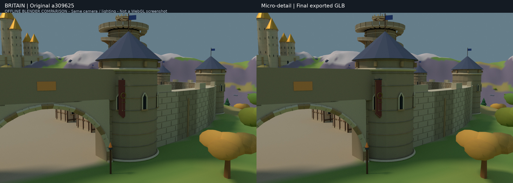
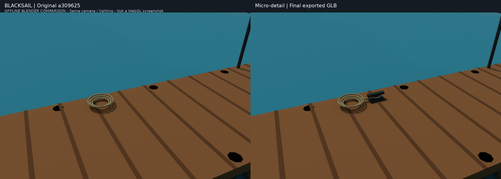
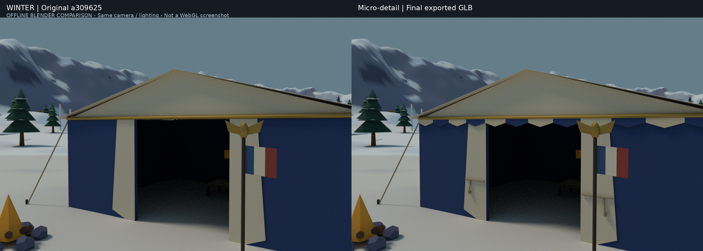
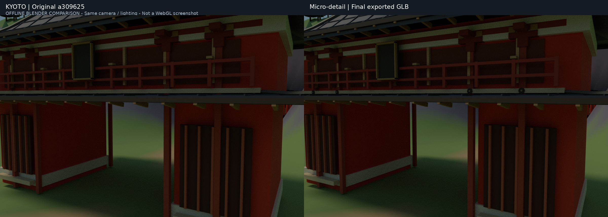

# World 地图小幅细化（2026-10-28，云端验收）

在已精修的五个区域上仅补一层近景工艺细节，**不改布局、不重做建筑、不散布杂物**。

> 本页统计的是微细化本身。其后用户追加「空气墙移到大柱子屏障」：仅 Alpha 四个时层门
> COLLISION 及四个同形动态可见力场作独立变更，增加 240 ART 三角面、4 个动态网格、
> 13,908 B，不加描边；详见 [屏障对齐验证](WORLD_SEAM_BARRIER_ALIGNMENT.md)。
> 以下“全部碰撞不变/零网格增量”是微细化阶段结论，不适用于这项另行授权的屏障修正。

| 区域 | 本次细节 | 新增三角面 | GLB 增量 | 准备后的运行时分块增量 |
|---|---|---:|---:|---:|
| 幻日谷 | 营地舱体两侧嵌入式检修盖、固定件与橙色释放扣 | 336 | 3,584 B | 0 |
| 落日王国 | 两面王城旗帜的织边、挂杆与固定环 | 376 | 2,912 B | 0 |
| 黑帆尽头 | 三条栈桥各一处低矮系缆座，将原有盘绳接到固定件上 | 984 | 6,684 B | 0 |
| 永冬之城 | 皇帝帐篷的门帘束带、短穗与蓝白檐边 | 384 | 3,844 B | 0 |
| 业火京都 | 三座楼门梁柱交点的钉隐金具 | 1,536 | 11,472 B | 0 |
| **合计** | **沿用十个现有 ART 批次** | **3,616** | **28,496 B** | **0** |

最大单文件仍为京都：12,330,884 B（约 11.76 MiB）。没有新增材质、纹理、灯光或
着色器。五图的原始 ART primitive 数和实际 `chunkMesh` 生成的分块/描边数均保持
不变；这不是 GPU 帧率或逐帧 draw-call 测量，也不宣称提升 FPS。

## 不变项与验证

- 五份完整 layout JSON **逐字节不变**：传送点、路线、任务、门、灯光意图均保留。
- 以原始 `a309625` 资产为只读基线：所有 COLLISION、Terrain、MARKERS、任务/动态
  物件，以及白名单外的每个 ART 节点，其解码 accessor/index 哈希、变换和元数据精确相等。
- 十个允许修改的 ART 批次也保持原有节点变换、材质和元数据。没有改 Arena 资产，
  没有改 World 运行时主循环或角色模块。
- 旧 `five-world-baseline.json` 未覆盖。上一次「只改两区」的三个整文件冻结断言，
  被本次五区允许变更范围的严格节点白名单、三角面/字节预算和真实分块预算替代。
- 地图专项测试 **102/102 通过**；新增五区白名单/运行时分块测试 **5/5 通过**；
  `npm run typecheck` 通过。五个生成器重建后逐文件 SHA-256 重复性检查通过。
- 构建使用同一入口的 `node --import tsx tools/build-*.ts`：`tsx` CLI 自身的 IPC
  socket 在此容器被拒绝，未更改安全设置。

开发中实际检查到：六个系缆座会让一个铁件批次跨过 4,000 三角面分块阈值，造成
11 个额外分块；因此收敛为三处有用途的细节，最终分块数完全不增。

## 实际资产前后对比

以下来自原始/最终 **GLB 的 Blender 离线渲染**，不是生成式概念图或浏览器截图。
两侧镜头、光照和采样参数一致。仅用于核对形体、连接、留空与导出颜色，不代表
运行时卡通光照效果。Chromium 正常沙箱启动在打开页面前遇到 `socket() EPERM`；
没有禁用沙箱重试，因此 WebGL/真实交互/FPS 没有完成验收。

每张左侧是 `a309625`，右侧是本次最终资产。

### 幻日谷 · 舱体检修盖

### 落日王国 · 王城旗帜

### 黑帆尽头 · 栈桥系缆

### 永冬之城 · 皇帝帐篷

### 业火京都 · 梁柱金具

复现入口、不可变基线与固定镜头：[map-polish QA](../world/validation/map-polish/README.md)。
精确字节数及最终文件哈希：[metrics.json](../world/validation/map-polish/metrics.json)。
