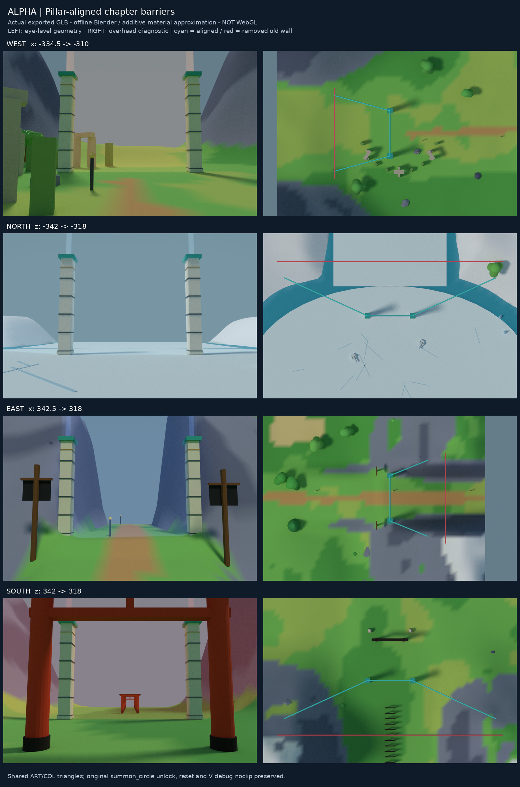

# 初始区域大柱子屏障对齐（2026-10-28，云端验收）

Alpha 幻日谷没有营地专属的空气墙；四个通往章节区域的时层门，原碰撞都位于
既有双柱屏障后方约 24 米的空地。本次统一将四门前沿移回**现有 15 米高双柱与
门幕所在平面**。出生点、全球边界、区域链接、任务/交互点和解锁顺序均未移动。

| 门 | 旧阻挡平面 | 新前沿＝原双柱/门幕平面 | 两侧柱中心 | 保留的垂直碰撞范围 |
|---|---|---|---|---|
| 西／落日王国 | x = −334.5 | **x = −310** | z = −40、−20 | y ≈ −6.326…73.674 |
| 北／永冬之城 | z = −342 | **z = −318** | x = −10、10 | y = −8.88…71.12 |
| 东／黑帆尽头 | x = 342.5 | **x = 318** | z = 20、40 | y ≈ 5.847…85.847 |
| 南／业火京都 | z = 342 | **z = 318** | x = 30、50 | y = 0…80 |

新前幕厚 0.6 m，胶囊半径 0.35 m；正常玩家脚点到屏障中心面的最小距离约
0.65 m。每门两个短回折力场从柱边接到**原有**区域链接口角落，端点重叠 0.75 m，
避免只平移前幕后从两端绕出。回折也是可见场体，不在空地另加隐藏封路墙。

- 西回折末端：`(−334.75, −46.75)`、`(−334.75, −13.25)`。
- 东回折末端：`(334.75, 13.25)`、`(334.75, 46.75)`。
- 北回折末端：`(−46.75, −334.75)`、`(46.75, −334.75)`。
- 南回折末端：`(−6.75, 334.75)`、`(86.75, 334.75)`。

每门前幕和两片回折共用一个动态网格/碰撞体，仍仅由 `summon_circle` 解锁。
`tower_console` 不会提前开门；进度重置后，三个面一起恢复。旧空地处的墙已移除，
而非保留旧墙再叠加新墙。

## 视觉与碰撞语义

可见 ART 与 COLLISION 的**全部 60 个三角面**逐门匹配，不仅是外包围盒或中心点。
保留原 80 m 高的防空绕行范围；这不是新增 80 m 实心建筑。沿用现有 `M_Beam`
透明叠加材质，双柱高度内顶点着色强度为 0.22，柱顶以上渐淡至顶端 0.025，材质
透明度仍为 0.28。上方为很淡的场体延伸，主要可读屏障仍在双柱与回折入口处。

显式 **V 调试无碰撞飞行保持原样**，不会受普通碰撞拦截；没有新增调试模式锁。
正常步行、跳跃、滑翔和上升气流测试均使用真实 Player 与实际导出 BVH。

## 验证

- 18 个专项测试：实际压缩 GLB 解码；每个可见三角面与碰撞逐项一致；原柱几何
  验证；每门 3 面 × 5 采样位置 × 4 高度（共 240 次真实胶囊移动）；上升气流抬升
  超过柱顶；两端/回折/边界连接；解锁、重置；旧墙消失。
- 对真实碰撞的局部网格泛洪搜索不能绕任一门端点进入未解锁通道。
- 出生点仍为 `spawn_p1 [3,20,159]`；重置后落地稳定，可正常离开营地。
- 加上五图严格变更白名单、历史碰撞基线检查共 **27/27 通过**；TypeScript 检查通过。
  独立 QA 另检查四门的原柱坐标、多高度 ART/COL 接触平面。
- 只豁免四个明确的 `COL_Seam_*_Gate` 与四个对应新增 ART 节点；完整 layout JSON、
  地形、静态碰撞、其它动态物体、材质和基线白名单外内容精确冻结。未重录基线哈希。
- 本项增加 **240 ART 三角面、4 个动态网格、0 个描边、13,908 B**。
  Alpha GLB 为 **3,806,384 B**；未改其它区域资产或运行时主循环。

复现：

```sh
cd world
node --import tsx tools/build-world.ts
node --import tsx --test validation/seam-barrier.test.ts validation/seam-qa.test.ts \
  validation/map-polish.test.ts validation/kingdom-valley-export.test.ts
npm run typecheck
node --import tsx validation/seam-barrier/export.ts
node validation/kingdom-valley/decode.mjs public/assets/world_alpha.glb /tmp/alpha-seam-decoded.glb
blender -b -t 2 -P validation/seam-barrier/render.py -- /tmp/alpha-seam-decoded.glb \
  ../docs/seam-barrier validation/seam-barrier/geometry.json
```

精确世界坐标/包围盒、固定相机和最终资产哈希见
[`geometry.json`](../world/validation/seam-barrier/geometry.json)。

## 实际资产离线预览

下图用最终 GLB 的实际几何在 Blender 离线渲染；透明场材质明确近似运行时
additive 显示意图，不是浏览器/WebGL 截图，也不是概念图。俯视诊断隐藏半透明场面以看清地形，青线表示
新前幕/回折碰撞，红线表示已移除的旧空地墙。诊断线为标注，不会导入游戏。



Chromium 正常沙箱启动仍受 `socket() EPERM` 限制；没有禁用沙箱或更换用户电脑
绕过限制。真实 WebGL 透明排序、交互实测和完整真人游玩尚未验收。
