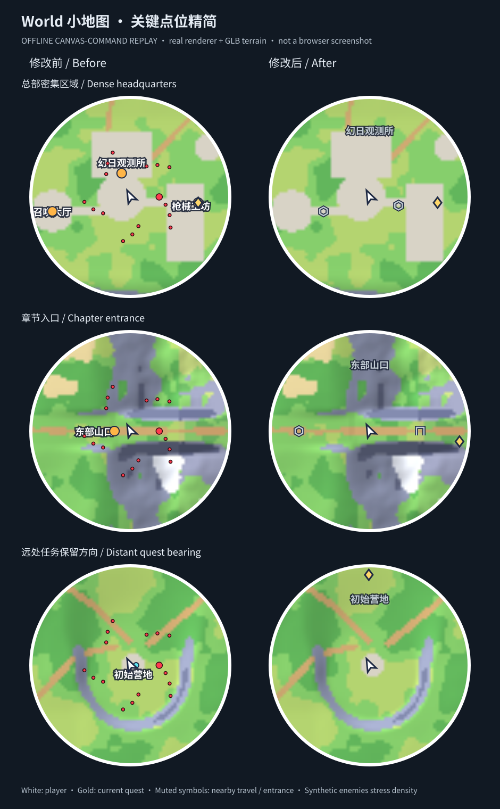

# World 小地图：只保留关键点位（云端验收）

- 玩家：白色方向箭头。
- 当前任务：金色菱形；任务在小地图范围外时，保留圆形边缘方向标记。到达任务点时仍可看到玩家箭头外的金色轮廓。
- 附近现有传送目的地／章节入口：统一低饱和灰蓝色符号，最多 3 个；按距离筛选、重叠去重，避让玩家与当前任务。章节入口优先。没有新增传送操作或改变章节门的解锁条件。
- 小地图不再绘制普通互动、发现、出生点、静态敌人或实时怪物圆点（包括 Boss）；Boss 若是当前任务，仍由金色当前任务标记表示。
- 最多一个当前位置区域名；若与当前任务标记冲突，优先保留任务。地形底图不改。
- 本轮当时未修改大地图；随后按 M 完整地图也已精简，现行策略见 [完整地图修正](WORLD_FULL_MAP_SIMPLIFICATION.md)。下方“大地图一致”是上轮验收记录，不是现行设计要求。

## 验证

```bash
cd world
node --import tsx --test validation/minimap-markers.test.ts validation/regression.test.ts
npm run typecheck
node --import tsx validation/minimap/render-preview.ts
```

聚焦测试 20/20 通过，类型检查通过。覆盖纯策略与实际 `WorldMap.draw`：密集区域上限、稳定去重、当前目标优先、圆形视口边缘方向、目标切换／清除／到达、无普通怪物圆点、五个真实地区的全部传送点和入口、X/Z 对齐、大地图原有信息。根任务另行执行最终全套回归与构建。

## 离线画面证据



这是**离线 Canvas 绘制命令回放，不是浏览器或 WebGL 截图**：旧版和新版真实 `WorldMap.draw` 使用相同位置、视角、任务和真实五地区 GLB 烘焙地形；Canvas 命令转为 SVG，再通过现有 sharp 渲染。三组场景分别是总部密集区域、章节入口、远处任务方向。旧／新大地图的绘制命令在这三组真实布局场景中逐项完全一致。

为检查密集点位，画面输入了每场景 16 个合成敌人位置，**不是实际敌人分布**。字宽采用确定性近似，字体栅格化与浏览器可能有差别；脉动时间固定为 0。完整方法和基线提交见 [manifest](../world-minimap/manifest.json)。

正常 Chromium 先前因沙箱进程单例 socket EPERM 无法启动，本次未重试、绕过或使用用户桌面。因此真实浏览器 HUD、实时游玩和部署不在本次已验证范围内。
