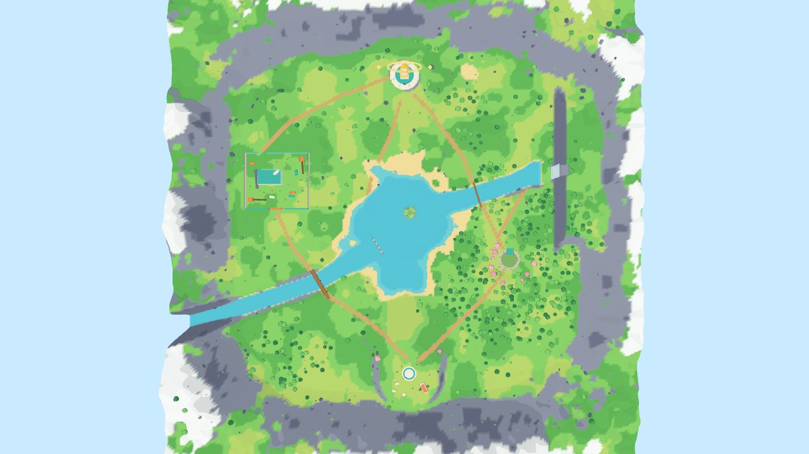

# 幻日谷 Sundog Valley — World 首区设计（Alpha 白盒 v1）

> 对应计划：Alpha 蓝图 §2「World：单人离线可完成 10–15 分钟目标；至少一处隐藏发现与一场 PvE 战斗；至少 2 人合作」，
> 项目计划 V2 第 07 章「山谷 + 森林 + 研究设施 + 洞穴」。本版只做**地图结构**（地形、建筑、动线、碰撞、标记点），
> 不含敌人 AI、网络和正式美术。

## 1. 参考与设计思路

| 参考 | 借用的做法 | 在幻日谷里的体现 |
|---|---|---|
| 《塞尔达：旷野之息》初始台地 | 出生点在高处，第一眼就看到全图主要地标，“看到哪里就能去哪里” | 降落营地在南侧高台，正对北面的幻日塔，左看观测站、右看瀑布 |
| 《原神》蒙德/璃月区域 | 山脉围成自然边界；远处大地标 + 中距离小地标；路边小谜题和宝箱 | 环形雪山作边界；幻日塔光环为主地标；石柱跳台宝箱、靶子机关 |
| 竞技 FPS 据点（CS/Valorant 进攻点思路） | 一个据点至少三条进入路线、有高点但不无解 | 观测站：正门 / 东侧破墙 / 北侧后门，屋顶和两座瞭望塔是高点 |
| 计划书“自然覆盖的科研遗迹群” | 世界观 | 旧观测站、森林遗迹、幻日塔都是同一个科研机构的遗迹 |

**名字由来**：Parhelion = 幻日（太阳两侧的“假太阳”）。天空着色器画了 22° 光晕和两个幻日；幻日塔的金色光环和左右两颗菱形晶体是同一个图形母题，完成目标后会点亮。

## 2. 尺寸与比例

- 地图 480 × 480 m，可玩区约 400 × 400 m（隐形墙在 ±214 m），外圈是 50–80 m 高的环形雪山。
- 步行 5.5 m/s、奔跑 9 m/s：营地→塔直线约 330 m，步行约 1 分钟；完整目标路线约 1.2 km，加上解谜和战斗目标 10–15 分钟。
- 坐标：Y 向上，+X 东，−Z 北，单位米。

## 3. 区域

| # | 区域 | 位置 | 作用 |
|---|---|---|---|
| 1 | **降落营地** | 南，高台 20 m | 出生点（P1/P2 两个合作出生点）、存档终端；俯瞰全图 |
| 2 | **镜湖** | 中心 | 视觉中心与方向参照；湖心岛有石柱跳台宝箱（隐藏发现 2） |
| 3 | **回声森林** | 东 | 密林 + 遗迹圆形广场：**环境谜题**（射中 3 个机关靶 → 神龛门打开 → 中继器 A） |
| 4 | **旧观测站** | 西北 | **PvE 据点战斗**：围墙、两层主楼（屋顶可上）、2 座瞭望塔、集装箱/箱子掩体；中继器 B |
| 5 | **幻日塔** | 北，山丘 30 m | 最终目标：控制台（需要 A、B 两个中继器）；全图最高地标 |
| 6 | **雾瀑** | 东侧悬崖 | 瀑布后面藏着洞穴（隐藏发现 1）；沿岸发光小花是线索 |
| 7 | **西岸渡口** | 西南 | 木桥过河；另有湖口踏石和森林独木桥共 3 个过河点 |

## 4. 主目标：重启幻日塔（单人离线 10–15 分钟）

1. 营地出发（任意路线）。
2. 回声森林遗迹：射中 3 个机关靶（低柱顶、最高柱顶、神龛屋顶）→ 神龛门打开 → 启动 **中继器 A**。
3. 旧观测站：侦察（外面的高地/西北山脊）→ 自选入口（正门正面推进 / 东侧破墙侧翼 / 北侧后门绕后）→ 清理敌人 → 启动主楼内 **中继器 B**。
   北侧后门直通去塔的小路，也是“打完后的撤离路线”。
4. 幻日塔：塔下守卫（含 1 精英）→ 启动控制台 → 光环点亮。

A、B 顺序自由。对应计划书“AI 据点：侦察 → 自选进入点 → 对抗 → 安全出口”。

## 5. 隐藏发现

| 发现 | 线索 | 路线 |
|---|---|---|
| 瀑布后的观测日志（故事碎片 + 武器外观） | 从森林到瀑布的小路边有一串发光小花；瀑布水帘后能隐约看到洞口 | 沿瀑布潭南岸的浅滩走到水帘后面进洞 |
| 湖心石柱宝箱 | 从营地和湖边都能看到湖中央的高石柱和金色宝箱 | 游到湖心岛，沿 10 级浮石跳台螺旋跳上去 |

## 6. 合作（W6 用）

- `spawn_p1` / `spawn_p2` 两个出生点；目标/机关/中继器都是一次性的世界状态，按计划书由权威端（房主）执行一次。
- 观测站有 3 个入口，两人可以分头从正门和破墙夹击；不需要“两人同时按键”的硬门槛。

## 7. 战斗空间（观测站）要点

- 围墙 70 × 62 m，墙高 5 m；主楼 26 × 16 m，屋顶 12.9 m，带 1 m 女儿墙，西侧坡道上屋顶。
- 两座瞭望塔平台高 6 m，各自一条坡道；屋顶和塔都能被地面掩体反制（箱子、集装箱、水泥墩共 20 个，全部写成 `cover` 标记点）。
- 7 个敌人刷新点（`enemy` 标记），给后面的掩体选择 AI 训练用。

## 8. 技术说明

- 整张地图由 `tools/build-world.ts` 按种子 `20261026` 生成，同一种子输出字节完全一致（已验证 md5）。
- 输出 `public/assets/world_alpha.glb`：
  - `ART`：可见模型（地形、水、建筑、树、石头……），顶点色 + 卡通材质名约定（`M_Toon` / `M_Foliage` / `M_Emissive` / `M_Water` / `M_Halo` …）
  - `COLLISION`：独立碰撞体（地形 + 简化的建筑/树干/坡道 + 边界墙），与美术网格分离；`Ruin_Door` 和机关靶是可开关的动态碰撞体
  - `MARKERS`：空节点，名字为 `MK_<类型>_<id>`，extras 里有完整数据
- `public/assets/world_alpha.layout.json`：区域、河流、小路、45 个标记点、目标步骤；给查看器、以后的服务器和 AI 用。
- 可直接导入 Blender（File → Import → glTF 2.0）做美术替换，节点名请保持不变。
- 约 16 万三角面、9.4 MB；查看器约 30–40 个 draw call。

## 9. 已知限制 / 下一步

- 地形是 2 m 网格高度图，近看路面边缘有锯齿；正式美术阶段换贴图或在 Blender 里精修。
- 树和石头是程序摆放，未做 LOD/实例化（目前性能足够；超预算再做）。
- 查看器的移动控制只是看图用的，正式移动要放进共享的 `applyInput(step, state)` 规则里。
- 敌人、伤害、存档到 IndexedDB、合作同步都不在本版范围。
