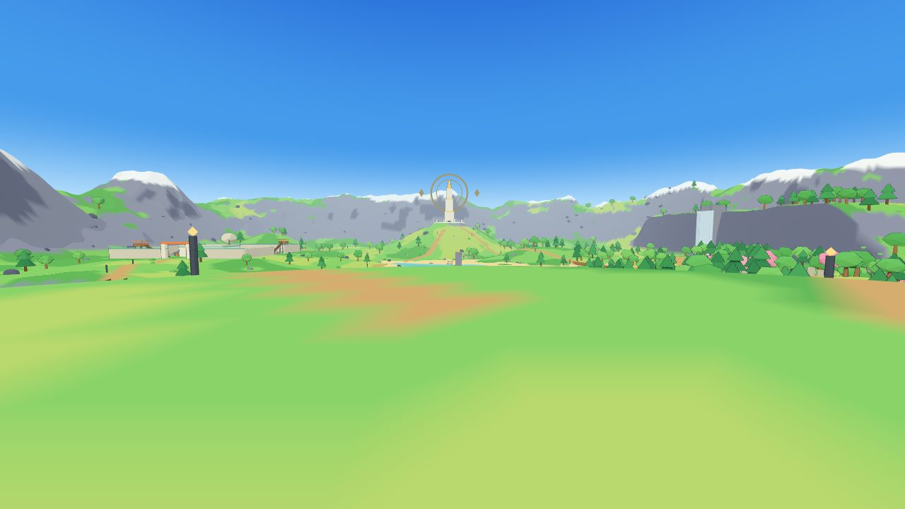
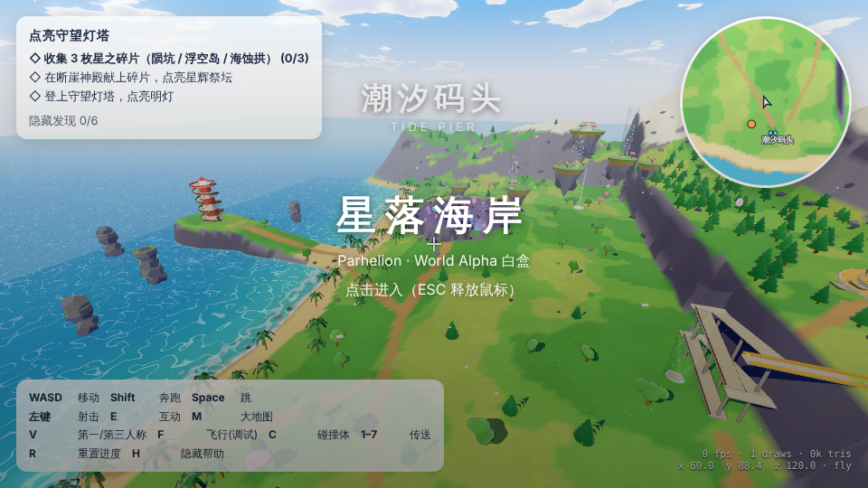

# world/ — 幻日谷 (World 首区) 白盒

Parhelion Alpha 的大世界首区：程序生成的白盒地图（GLB）+ 浏览器第一人称查看器。
设计说明见 [DESIGN.md](DESIGN.md)。这个目录是独立的，不依赖也不改动仓库里的其它部分（例如 Arena）。



## 运行

```bash
cd world
npm install
npm run dev          # 打开 http://localhost:5173
```

地图文件已经提交在 `public/assets/`，直接运行即可。修改了 `tools/gen/*` 之后重新生成：

```bash
npm run build:world  # 重新生成 world_alpha.glb + world_alpha.layout.json（同种子结果一致）
npm run build:coast  # 重新生成区域 2「星落海岸」world_coast.glb + layout
npm run build        # 类型检查 + 打包到 dist/
```

## 操作

| 键 | 作用 |
|---|---|
| 点击画面 | 锁定鼠标进入 |
| WASD / Shift / Space | 移动 / 奔跑 / 跳（空中再按 Space 展开滑翔翼） |
| V | 第一 / 第三人称 |
| 左键 | 射击（可打机关靶） |
| E | 互动（中继器、控制台） |
| M | 大地图 |
| 1–7 | 传送到各区域（调试） |
| F | 飞行模式（调试，Q/E 下降/上升） |
| C | 显示碰撞体 |
| R | 重置进度 |

URL 参数（截图/调试）：`?region=coast`（星落海岸）、`?q=low`（低画质）、`?spawn=station`、`?cam=x,y,z,yaw,pitch`、`?clean`（隐藏 HUD）、`?lit`（点亮光环）、`?nofog`。

## 区域 2：星落海岸（Starfall Coast）



从幻日谷营地的「幻日门」（E 互动）或 `?region=coast` 进入；海岸的码头旁也有一座幻日门回幻日谷。

- **潮汐码头**（出生点）：高脚渔屋、栈桥、渔船、灯笼。
- **风铃草原**：花海与草海。
- **白沙湾**：海蚀拱，可以踩着石柱跳上拱顶。
- **守望灯塔**：在海岬上，沿外侧螺旋坡道登顶。
- **星陨坑**：陨石核心周围是发光晶簇，旁边有上升气流。
- **浮空群岛**：6 座浮岛，靠上升气流和滑翔翼逐岛前进，岛下有瀑布。
- **断崖神殿**：从折返石阶或山脚上升气流上到崖顶高台。

任务线：收集 3 枚星之碎片（陨坑、浮空岛、海蚀拱）→ 点亮断崖神殿的星辉祭坛（光柱冲天）→ 点亮灯塔（旋转光束）。另有 6 个隐藏发现。

新玩法与渲染：

- 滑翔翼（原神式）：空中按 Space 展开或收起；进入上升气流后自动展开。
- 水面会按深度变色（浅滩青绿、外海深蓝），岸边有浪花线和向岸推进的浪带，两张地图都生效。
- 环境里有飘落的花瓣和花粉。上升气流有螺旋风粒子和风壁。
- 后处理：MSAA、GTAO、Bloom 和体积光。草海用 GPU 实例渲染；树冠采用原神式球形法线。

`validation/coast-smoke.test.ts` 用真实碰撞体验证了以下路线：出生点和传送点能稳定落地；上升气流配合滑翔翼可以依次飞到 i1、i2、i3、i4；折返石阶能上到崖顶；灯塔螺旋坡道能走到顶。

## 目录

```
world/
  tools/build-world.ts     生成入口
  tools/gen/layout.ts      布局数据（区域、河流、路线、建筑位置）—— 改地图主要改这里
  tools/gen/terrain.ts     高度图地形 + 顶点色
  tools/gen/structures.ts  营地、观测站、遗迹、幻日塔、瀑布洞穴、桥、路灯、边界
  tools/gen/vegetation.ts  树、石头、灌木
  tools/build-coast.ts     区域 2 生成入口；tools/gen/coast/* 布局、地形、建筑与植被
  tools/gen/export.ts      各区域共用的 GLB/layout 导出
  src/                     Three.js 查看器（卡通材质、描边、天空、胶囊碰撞、小地图、目标流程）
  public/assets/           生成好的 GLB + layout JSON
  docs/                    截图
```

## 查看器修复与验证（2026-10-26）

- 只有进入鼠标锁定且大地图关闭时，移动、互动、重置和射击才有效；ESC / 切出窗口会清除按键，大地图打开时清空并阻止操作。
- 飞行模式的 E 只负责上升，不会同时启动中继器；传送和切换飞行会清除旧的落地/游泳状态。
- 小地图的 X/Z 坐标分别使用正确的视口偏移。
- 地图布局先检查 HTTP 响应与数据结构；加载失败显示原因和“重新加载”按钮，鼠标锁定失败也可以再次点击。
- 保留地图生成器、美术资产、布局与总体风格，不涉及 Arena。

```bash
npm ci
npm test              # 19 项：真实源码输入集成、地图、加载、胶囊碰撞和真实 GLB smoke
npm run typecheck
npm run build
```

详细覆盖范围与当前浏览器验证限制见 [validation/VALIDATION.md](validation/VALIDATION.md)。
