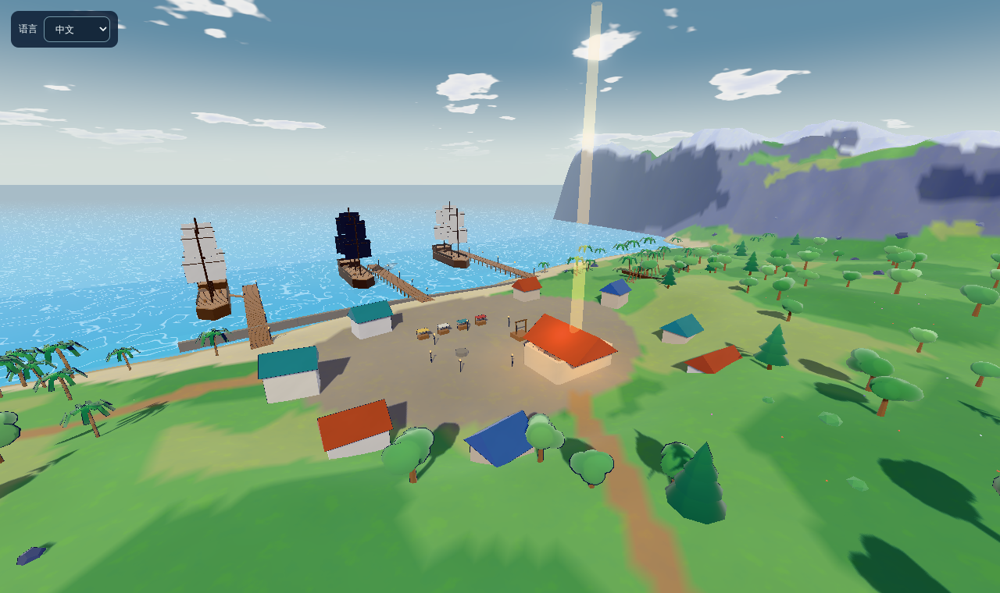

# world/ — 幻日谷 (World 首区) 白盒

Parhelion Alpha 的大世界首区：程序生成的白盒地图（GLB）+ 浏览器第三人称探索查看器。

## World 00 · 幻日谷（World Architecture v1.0）

幻日谷是 2026 年的现代总部，地图扩大到 720 × 720 m（原来 480 m），可玩区 ±334 m：

| 区域 | 位置 | 内容 |
|---|---|---|
| A. 初始营地 | 南侧高台 | 出生点 |
| B. 幻日观测所 | 西南园区 | 观测终端、世界地图全息台、圆顶望远镜 |
| C. 枪械工坊 | 园区东侧 | 武器架 + 三道靶场（练习靶） |
| D. 召唤大厅 | 园区西侧 | 圆柱回廊和召唤阵，任务完成后亮起光柱 |
| E. 幻日塔 | 北 | 重启后三处时层断面显现 |
| F. 湖区与山口 | 中部 / 边缘 | 西部时层（落日王国）、北方冰海断面（永冬之城，冰面可走）、东部山口（黑帆尽头，无缝相连） |

主线 9 步：观测终端 → 领取装备 → 靶场 → 森林机关靶 → 中继器 A → 前哨站中继器 B → 幻日塔 → 调查三处时层断面 → 稳定召唤阵。
原来的回声森林、镜湖、雾瀑、废弃前哨站（原“旧观测站”）都保留在原位置。
设计说明见 [DESIGN.md](DESIGN.md)。地图生成器独立维护；运行时共享仓库根部的 `assets/weapons` 美术与 `shared-client` 操作设置，不导入 Arena 战斗规则。


## World 01 · 落日王国（白盒 v1）

约 537 年的不列颠，720 × 720 m，位于幻日谷正西（世界偏移 -720, 0）。从幻日谷西部时层断面沿峡谷无缝走进去；
召唤阵稳定（`summon_circle`）之前，断面口有一道看不见的门（`Seam_west_Gate`，`opensWhen`）。
生成：`npm run build:britain`（`tools/build-britain.ts` + `tools/gen/britain/*`）。直接从这里开始：`?region=britain`。

| 区域 | 位置（区域内坐标） | 内容 |
|---|---|---|
| 迷雾森林 | 东 (230, -20) | 断面石环、发光蘑菇、隐士林中祠 |
| 圣剑湖 | 中 (40, 90) | 木栈桥通向湖心岛，湖中之剑 = 与 Saber 缔结契约 |
| 骑士营地 | 东北 (170, -200) | 木栅营地、帐篷；射倒 3 个试炼木人 → 碎片·誓约 |
| 卡美洛外围 | 西北高台 (-190, -190) | 城墙、城镇、集市；主塔外侧螺旋坡道 → 碎片·王座 |
| 圆桌大厅 | 城内 (-215, -165) | 圆桌 13 席；点燃 3 个火盆 → 碎片·圆桌 |
| 卡姆兰战场 | 西南 (-200, 200) | 焦土、断矛；集齐契约 + 三碎片后点亮落日之核（Boss 空位之王占位） |

远处西北山脊上是真正的卡美洛（远景，Alpha 不可进入）。黄昏天空与首个可挑战 Boss 已接入；区域流式加载仍为后续步骤。详见 [可玩迭代说明](../docs/KINGDOM_ITERATION.md)。
`validation/britain.test.ts` 走通：断面门、峡谷 → 湖、栈桥、营地、王城 → 圆桌、主塔螺旋、卡姆兰。

## 运行

```bash
cd world
npm install
npm run dev          # 打开 http://localhost:5173
```

地图文件已经提交在 `public/assets/`，直接运行即可。修改了 `tools/gen/*` 之后重新生成：

```bash
npm run build:world  # 重新生成 world_alpha.glb + world_alpha.layout.json（同种子结果一致）
npm run build:blacksail  # 重新生成 World 02「黑帆尽头」world_blacksail.glb + layout
npm run build        # 类型检查 + 打包到 dist/
```

## 操作

| 键 | 作用 |
|---|---|
| 点击画面 | 锁定鼠标进入 |
| WASD / Shift / Space | 移动 / 奔跑 / 跳（空中再按 Space 展开滑翔翼） |
| E 或右键按住 | 第三人称肩射瞄准；视野缩放、双手持枪抬起 |
| O | 按键 / 普通与开镜灵敏度设置 |
| 左键 | 射击（可打机关靶） |
| F | 互动（中继器、控制台） |
| M | 大地图 |
| 1–7 | 传送到各区域（调试） |
| V | 三维自由飞行调试：W/S 跟随镜头俯仰升降，A/D 横移；不新增手动升降键 |
| T | 契约后召唤／收回 Saber，可在设置改键 |
| C | 显示碰撞体 |
| G | 任务指引开/关（屏幕路标 + 光柱 + 地图标记，跨区域会先指向东侧山口） |
| R | 重置进度 |

URL 参数（截图/调试）：`?region=blacksail`（黑帆尽头）、`?region=britain`（落日王国）、`?q=low`（低画质）、`?spawn=station`、`?cam=x,y,z,yaw,pitch`、`?clean`（隐藏 HUD）、`?lit`（点亮光环）、`?nofog`。

## World 02：黑帆尽头（Black Sail's End，1718）



1718 年的加勒比海，海盗黄金时代的最后一年。它取代了原来的星落海岸原型，放在幻日谷正东（区域偏移 x +720，720 m 见方）。召唤阵稳定后，东侧山口的门就会打开，沿山口栈道一路走下去就是拿骚港，中间没有传送门（`?region=blacksail` 可以直接从栈道出生）。

- **山口栈道**：从幻日谷的东侧山口下到海边，路边有绳栏和灯笼。
- **拿骚港**：三条栈桥，每条旁边停着一艘可以走上去的帆船（中间那艘挂黑旗）。另有酒馆（黑胡子在这里，契约标记也在这里）、绞刑架广场、集市和造船厂（藏宝图其一）。
- **走私者草原**：起伏的草地，有风车（藏宝图其二）、糖厂废墟和走私者洞口。
- **黑胡子要塞**：建在海崖上的星形要塞。炮台高出胸墙，先装填大炮，再站在炮位上击沉海上的 3 艘幽灵小艇，就能拿到碎片·火药。
- **浮空沉船群**：风暴漩涡上方悬着 5 艘沉船。踩上发光的上升气流，一艘接一艘滑翔上去，最高那艘上是碎片·罗盘。
- **骷髅礁**：沿沙洲走过去不用游泳。旁边沙嘴的尽头有一艘半沉的商船（藏宝图其三）。三片藏宝图拼齐后，X 标记亮起，在那里挖出碎片·藏宝。
- **亡航灯塔 + 幽灵舰队**：灯塔可以沿螺旋坡道登顶，顶上亮着冷灯。拿齐三枚碎片后，从灯塔石码头会出现一条幽灵栈桥（有碰撞），连过三艘幽灵船通到旗舰「安妮女王复仇号」。在旗舰上点亮海之核会触发 Boss 亡航提督，击败后冷灯熄灭、风暴散去，然后回酒馆和黑胡子签约。

天色：越往东走越接近暴风雨前的灰绿色天空，点亮海之核以后转晴（`src/twilight.ts`）。战斗系统现在支持每个年代各有一个 Boss（`BOSSES`，`src/combat.ts`），各自有独立的解锁条件和通关存档。

`validation/blacksail.test.ts` 用真实碰撞体验证了以下几点：山口门在召唤阵稳定前挡得住；从幻日谷能走到拿骚港；所有传送点都能稳定落地；酒馆、造船厂、风车、栈桥都能走到；要塞路线能上到炮位，炮位对三艘小艇的射界通畅；上升气流能把人依次送上 W1 到 W4；沙洲和半沉船都能走到；灯塔能登顶；幽灵栈桥出现前过不去，出现后能一路走到海之核。

## 目录

```
world/
  tools/build-world.ts     生成入口
  tools/gen/layout.ts      布局数据（区域、河流、路线、建筑位置）—— 改地图主要改这里
  tools/gen/terrain.ts     高度图地形 + 顶点色
  tools/gen/structures.ts  营地、观测站、遗迹、幻日塔、瀑布洞穴、桥、路灯、边界
  tools/gen/vegetation.ts  树、石头、灌木
  tools/build-britain.ts   World 01 落日王国；tools/gen/britain/*
  tools/build-blacksail.ts World 02 黑帆尽头；tools/gen/blacksail/* 布局、地形、建筑与植被
  tools/gen/export.ts      各区域共用的 GLB/layout 导出
  src/                     Three.js 查看器（卡通材质、描边、天空、胶囊碰撞、小地图、目标流程）
  public/assets/           生成好的 GLB + layout JSON
  docs/                    截图
```

## 查看器修复与验证（2026-10-26）

- 只有进入鼠标锁定且大地图关闭时，移动、互动、重置和射击才有效；ESC / 切出窗口会清除按键，大地图打开时清空并阻止操作。
- E 和右键均为按住肩射，F 互动；按用户最新要求移除了手动飞行升降。V 仅切换水平飞行调试，不能用俯仰或旧升降输入改变高度；正常跳跃、出水、滑翔与上升气流保持原规则。传送和切换飞行会清除旧的落地/游泳状态。
- 小地图的 X/Z 坐标分别使用正确的视口偏移。
- 地图布局先检查 HTTP 响应与数据结构；加载失败显示原因和“重新加载”按钮，鼠标锁定失败也可以再次点击。
- 保留地图生成器、美术资产、布局与总体风格，不涉及 Arena。

```bash
npm ci
npm test              # 真实源码输入、设置、持枪、地图、加载、胶囊碰撞与 GLB smoke
npm run typecheck
npm run build
```

详细覆盖范围与当前浏览器验证限制见 [validation/VALIDATION.md](validation/VALIDATION.md)。

## 本次武器与操作接入（未发布）

- World 游戏视角固定第三人称，不再用 V 切成 FPS；固定相机 URL `?cam=` 仍仅用于调试截图。
- 探索者原来的程序化 Lumen AR 换为曙光 GLB，按实际握把/护木锚点重新匹配双手；游泳/滑翔沿用背负状态。加载失败保留旧枪。
- 默认按住 E 或右键（任意一个仍按住即持续瞄准）：肩后相机从3.6m收近至1.5m，默认FOV75°→50°；枪械随俯仰抬起，双臂跟随握点。相机沿用地形碰撞回缩并检查肩侧墙体。射击仍按画面中心射线判定，不改机关靶或任务。
- O 或进入页设置按钮打开主／副按键、普通/开镜灵敏度与反转Y设置，保存于当前浏览器；与Arena设置独立。两个按键是“或”关系，不是组合快捷键。旧 v1 保存自动迁移至 v2，保留自定义映射和灵敏度，只删除已移除的升降字段；冲突逐项修复并明确通知，不整套重置。可恢复默认，动态提示跟随改键。
- 松开瞄准、Esc、地图、设置、失焦、游泳/滑翔/飞行都会清除肩射状态。其他5类未有战斗规则的模型没有伪装成World可用武器。

验证与发布限制见 [接入说明](../docs/WEAPON_INTEGRATION.md)。

## 操作更新验证（2026-10-26）

新增真实源码事件测试：E／右键双顺序按下与松开、设置／大地图／失焦／改键中断、过期 repeat 不恢复输入、F 互动不触发飞行。真实 Player 测试确认旧 `up` 输入、Space 和俯仰均不会在水平调试飞行中改变高度；原地面跳跃、水中出水、滑翔开关、气流抬升与三地区路线继续通过。未重试已知被云端环境阻止的浏览器；这些是源码与物理自动测试，不是实际 WebGL 操作验收。

## 精修 Artoria 双外观接入（2026-10-27，未发布）

默认使用已认可的战甲 R2，Esc 后点击右上角“从者 · 外观”可切换便服／战甲。契约与任务存档不变；四动画、跟随、召回与攻击接触说明见 [精修运行时说明](../docs/ARTORIA_RUNTIME_R1.md)。此前“水平飞行”段落是旧修复记录，现行 V 为随镜头俯仰的三维自由飞行。
